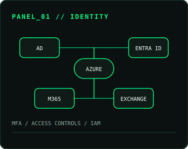
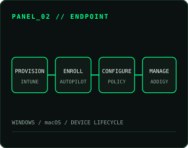
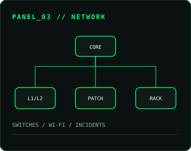
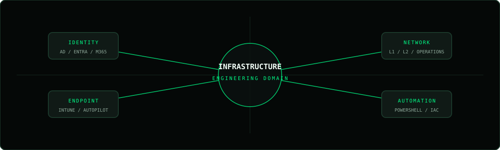
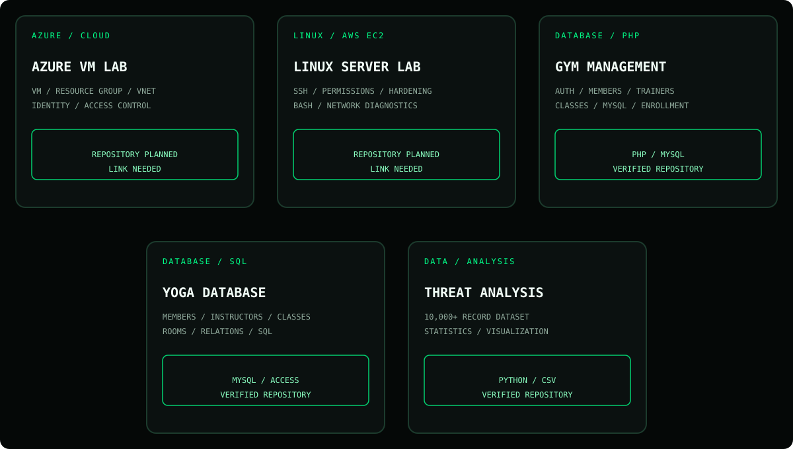

<div align="center">
  
</div>

<br>

```text
$ system.identity
> richard_fathalla
> IT Infrastructure / Systems / Cloud Technologies
```

IT infrastructure specialist with five-plus years supporting enterprise environments across identity, endpoint management, networking, and incident operations. Hands-on experience with Azure infrastructure, Microsoft 365, Active Directory, Entra ID, Intune, and endpoint deployment.

## Engineering Domains

<table>
  <tr>
    <td width="33%" align="center">
      
    </td>
    <td width="33%" align="center">
      
    </td>
    <td width="33%" align="center">
      
    </td>
  </tr>
</table>

## Engineering Schematic

<div align="center">
  
</div>

## Verified Projects

<div align="center">
  
</div>

| Project | Repository |
|---|---|
| Gym Management Web Application | [View repository](https://github.com/Richardadel/Gym-Management-System-Project) |
| Yoga Studio Database Management | [View repository](https://github.com/Richardadel/Yoga-Center-Project-) |
| Cybersecurity Threat Data Analysis | [View repository](https://github.com/Richardadel/MAT301) |
| Azure VM Infrastructure Lab | `Repository planned` |
| Linux / AWS EC2 Administration | `Repository planned` |

## Current Direction

```text
AZURE INFRASTRUCTURE  ·  POWERSHELL AUTOMATION  ·  INFRASTRUCTURE AS CODE
```

## Connect

[](https://www.linkedin.com/in/richardfathalla)
[](https://github.com/Richardadel)
