<div align="center">
  
</div>

<br>

```text
$ whoami
> Enterprise IT Professional
> Microsoft Azure | Entra ID | Intune
> Building toward Cloud & AI Infrastructure
```

## About

Computer Science graduate and enterprise IT professional based in New York City. Field Support Technician at **Spin Master** through **Insight Global**, providing primary onsite IT support for the NYC office and 100+ onsite users and remote employees.

I work across identity administration, endpoint management, infrastructure troubleshooting, and enterprise collaboration systems—then apply that operational experience to Azure, Linux, automation, and cloud infrastructure.

## Tech Stack

### Cloud & Identity


### Infrastructure & Systems


### Development & Automation


## Featured Projects

<table>
  <tr>
    <td width="50%" valign="top">
      <h3>Azure Cloud Infrastructure Lab</h3>
      <p>Hands-on Azure environment covering virtual machines, resource groups, virtual networks, subnets, identity, and access control.</p>
      <p>
        
        
        
      </p>
      <p><strong>Repository:</strong> <code>planned / link needed</code></p>
    </td>
    <td width="50%" valign="top">
      <h3>Linux Server Administration on AWS EC2</h3>
      <p>Linux administration lab for SSH, permissions, shell scripting, service configuration, hardening, and network diagnostics.</p>
      <p>
        
        
        
      </p>
      <p><strong>Repository:</strong> <code>planned / link needed</code></p>
    </td>
  </tr>
  <tr>
    <td width="50%" valign="top">
      <h3><a href="https://github.com/Richardadel/Gym-Management-System-Project">Gym Management Web Application</a></h3>
      <p>Database-driven gym platform with authentication, membership records, classes, trainers, and enrollment workflows.</p>
      <p>
        
        
        
      </p>
    </td>
    <td width="50%" valign="top">
      <h3><a href="https://github.com/Richardadel/Yoga-Center-Project-">Yoga Studio Database Management</a></h3>
      <p>Relational database system covering members, instructors, classes, schedules, rooms, memberships, and integrity constraints.</p>
      <p>
        
        
        
      </p>
    </td>
  </tr>
  <tr>
    <td colspan="2" align="center" valign="top">
      <h3><a href="https://github.com/Richardadel/MAT301">Cybersecurity Threat Data Analysis</a></h3>
      <p>Analysis of 10,000+ global cybersecurity threat records using descriptive statistics, visualization, and data exploration.</p>
      <p>
        
        
        
      </p>
    </td>
  </tr>
</table>

## Currently Building

```text
CURRENT_FOCUS = ["Azure Infrastructure", "PowerShell Automation", "Infrastructure as Code"]
```

## GitHub Activity

<div align="center">
  
</div>

## Connect

[](https://www.linkedin.com/in/YOUR-LINKEDIN)
[](https://github.com/Richardadel)
[](mailto:YOUR-EMAIL)
